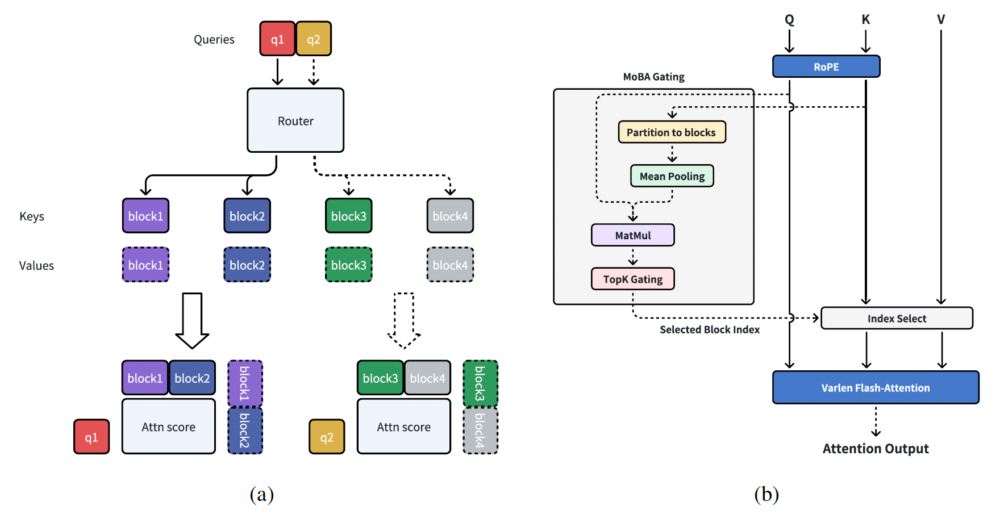
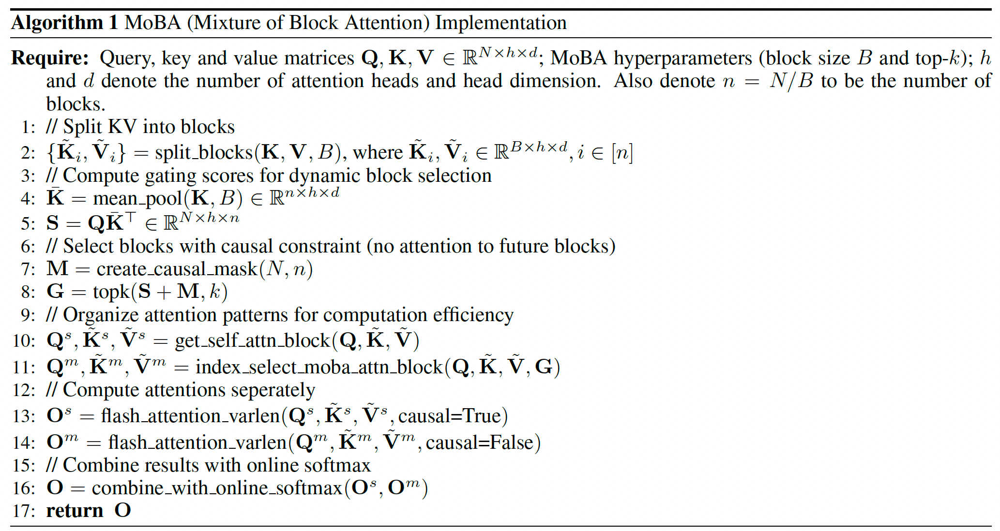

## 1 基本理论



MoBA 的核心思想是将 Keys 和 Values 分成连续的块，每个 q 只需要和部分的 block 计算注意力。

算法流程如下：



## 接口

```python
from attention.moba import moba

out = moba(
    q, k, v,
    cu_seqlens,
    max_seqlen=seqlen,
    moba_chunk_size=256,
    moba_topk=3,
    backend="auto",  # "reference" | "flash"
)
```

Q/K/V 为 packed varlen 布局 `(T, H, D)`，`cu_seqlens` 与 flash-attn 一致。

- 参考实现：[attention/moba/reference.py](../attention/moba/reference.py)
- flash-attn 后端：[attention/moba/flash.py](../attention/moba/flash.py)
- 示例：[examples/moba.py](../examples/moba.py)
